# Dashboard DIP · SECONSER Niterói

Painel dos serviços de iluminação pública do **Departamento de Iluminação Pública (DIP)** da SECONSER Niterói: a fila
em aberto, o prazo de atendimento, a evolução no tempo, o mapa, os pedidos de vereadores e os relatórios em PDF para
reunião e para a rua.

🔗 **[Acessar o dashboard](https://alves077.github.io/dashboard-seconser/)**

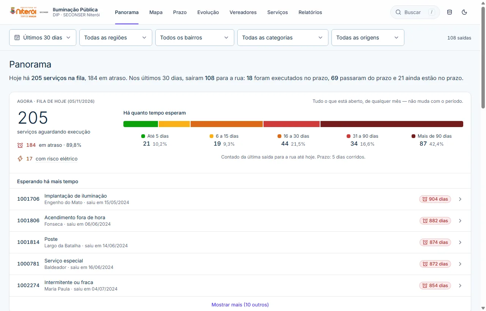

> As imagens deste README usam **dados fictícios** (o cenário de demonstração do modo de desenvolvimento, `?dados=demo`):
> números, endereços e nomes de vereadores são inventados. O site publicado mostra os dados reais.

## Páginas

Cada página responde a uma pergunta de quem usa:

| Página | Pergunta | O que mostra |
|---|---|---|
| **Panorama** | Como estamos agora? | fila de hoje por tempo de espera, saídas e execuções do período, movimento da fila, regiões, categorias, bairros e quem pede |
| **Prazo** | Estamos atendendo bem? | % no prazo de 5 dias, tempo até a execução, atraso de agora, reaberturas |
| **Evolução** | Está melhorando ou piorando? | saídas × execuções com a fila, tempo e prazo mês a mês, categorias |
| **Vereadores** | O que os vereadores pediram? | pedidos por vereador, situação e perfil de cada um |
| **Mapa** 🔒 | Onde está o problema? | um pino por serviço (abertos por padrão), painel por região e bairro |
| **Serviços** 🔒 | Onde está tal serviço? | todos os serviços, de qualquer data, com busca, situação, ordem por coluna e páginas de 50 |
| **Relatórios** 🔒 | O que levo para a reunião ou para a rua? | Mensal (mês, ano ou histórico), Em aberto, Executados e Lista de campo, na tela e em PDF A4 |

🔒 = só com login de quem tem acesso (equipe da DIP).

<table>
  <tr>
    <td width="50%">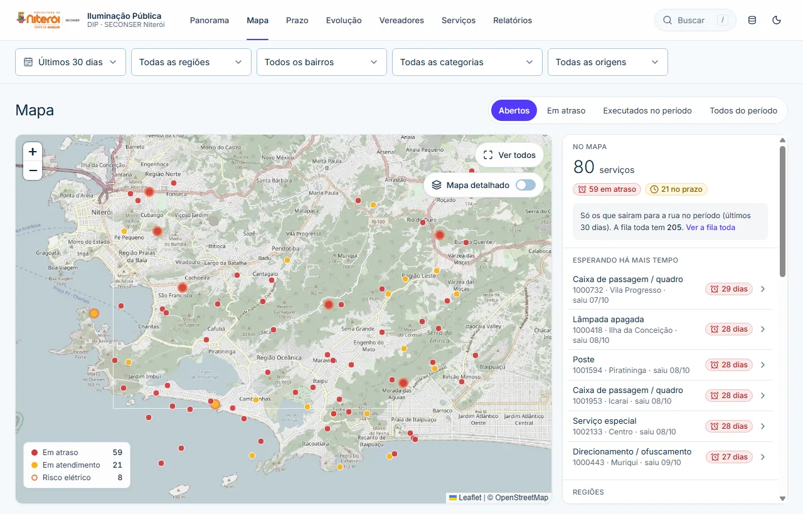<br><sub><b>Mapa</b> — em atraso, em atendimento e risco elétrico; painel com os que esperam há mais tempo</sub></td>
    <td width="50%">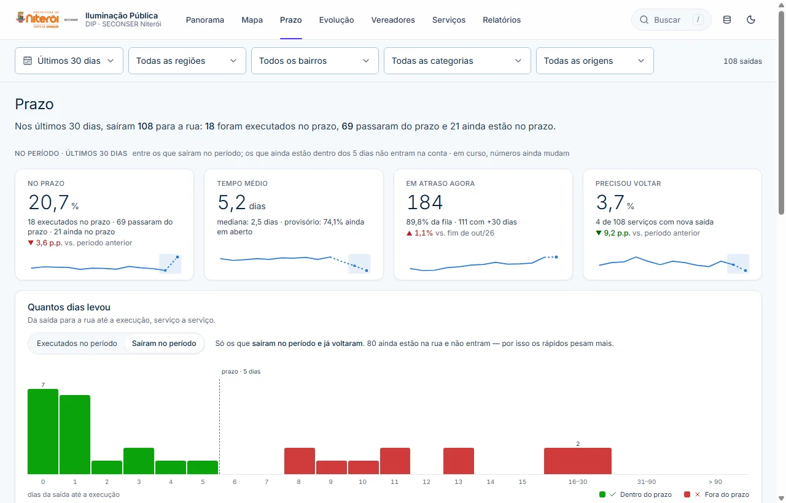<br><sub><b>Prazo</b> — quanto foi executado em até 5 dias e quanto tempo levou</sub></td>
  </tr>
  <tr>
    <td>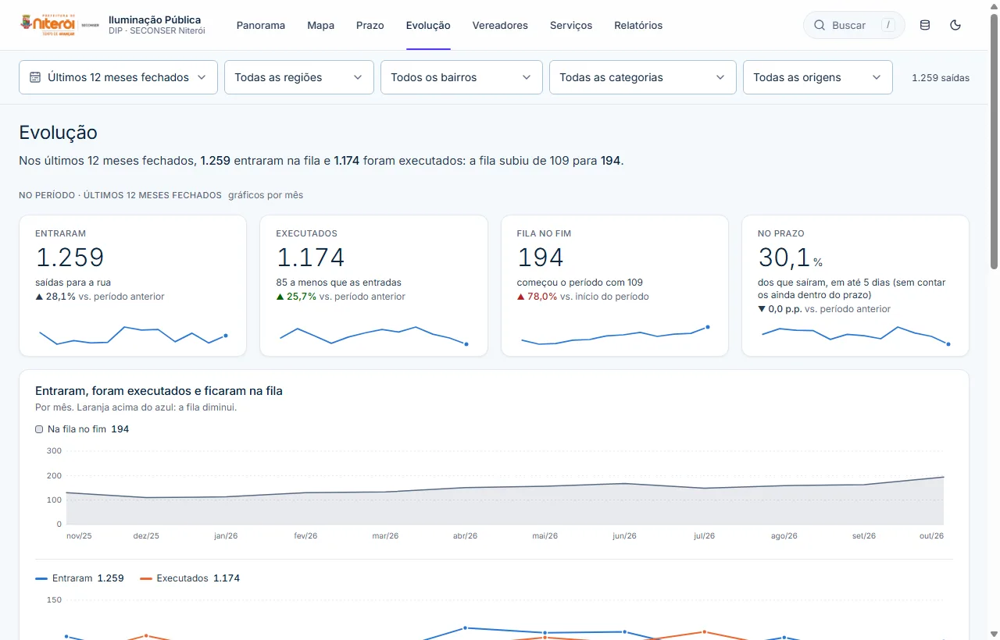<br><sub><b>Evolução</b> — entradas, execuções e a fila, mês a mês</sub></td>
    <td>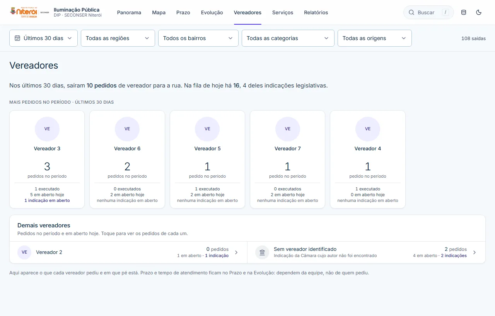<br><sub><b>Vereadores</b> — pedidos no período e em aberto hoje (nomes fictícios)</sub></td>
  </tr>
  <tr>
    <td>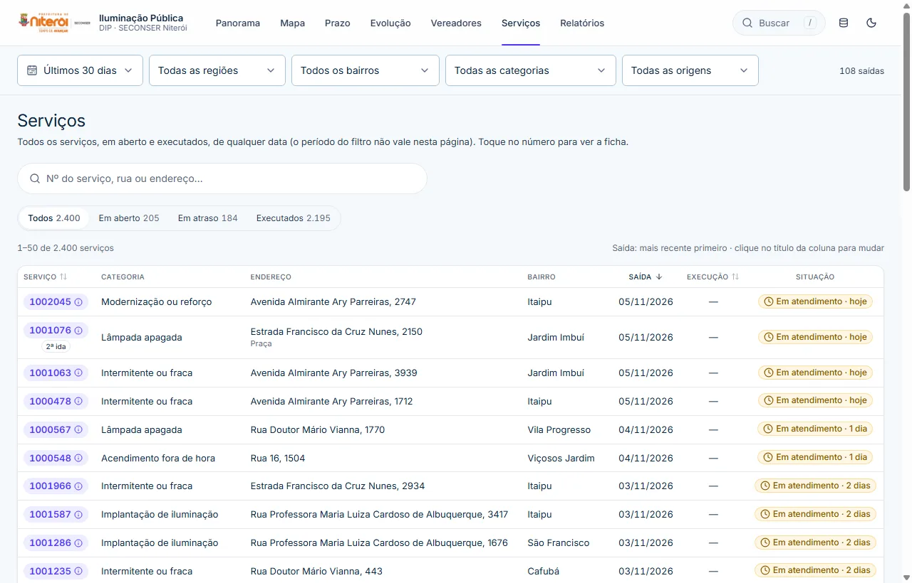<br><sub><b>Serviços</b> 🔒 — todos os serviços, com busca e situação</sub></td>
    <td>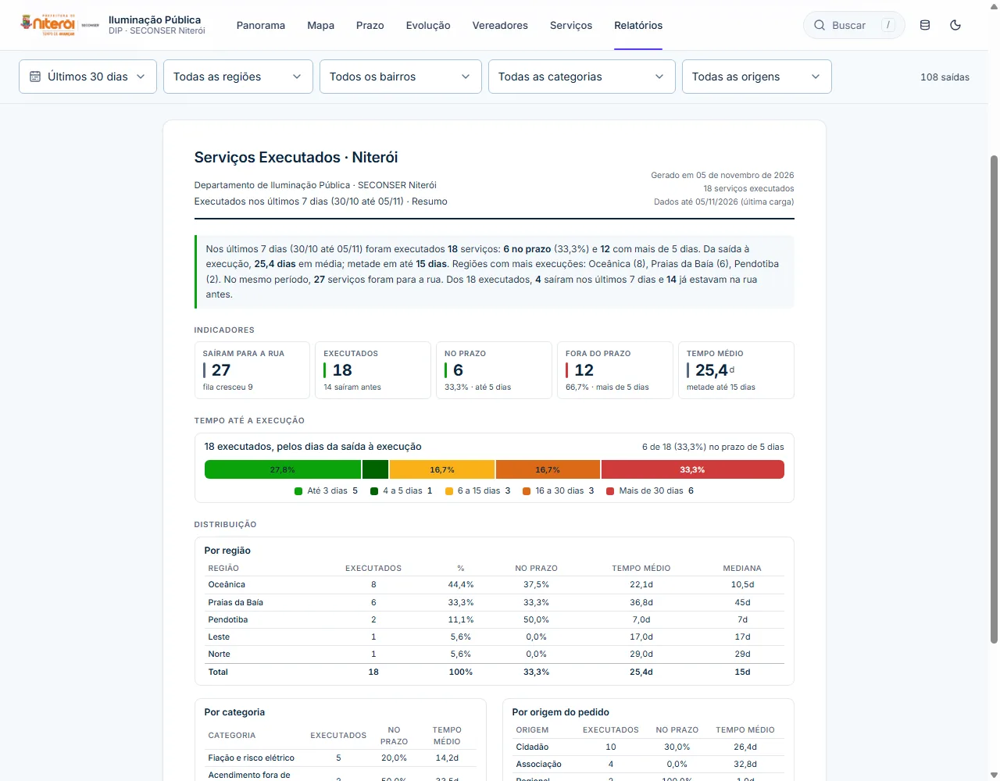<br><sub><b>Relatórios</b> 🔒 — Executados: indicadores, tempo até a execução e distribuição</sub></td>
  </tr>
  <tr>
    <td>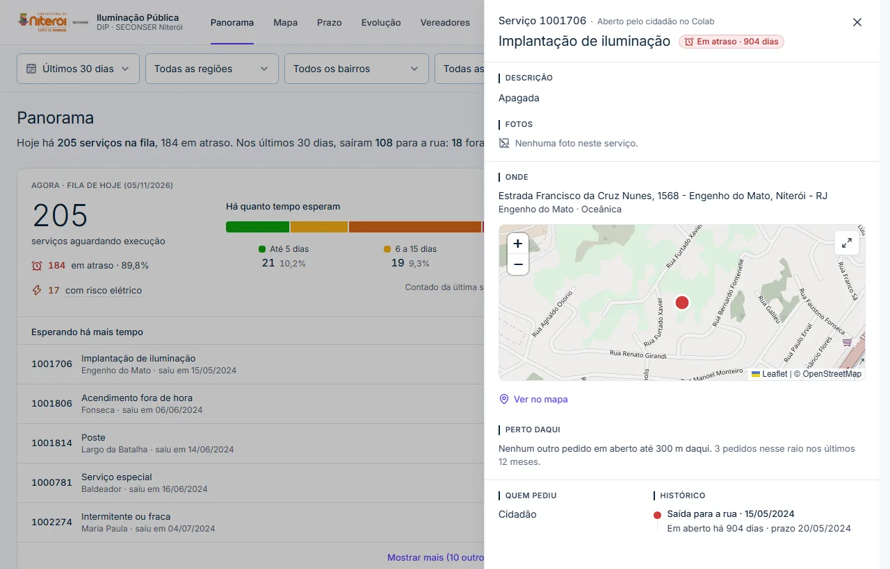<br><sub><b>Ficha do serviço</b> — histórico de saídas e "perto daqui"; mapa, descrição e endereço só com acesso</sub></td>
    <td>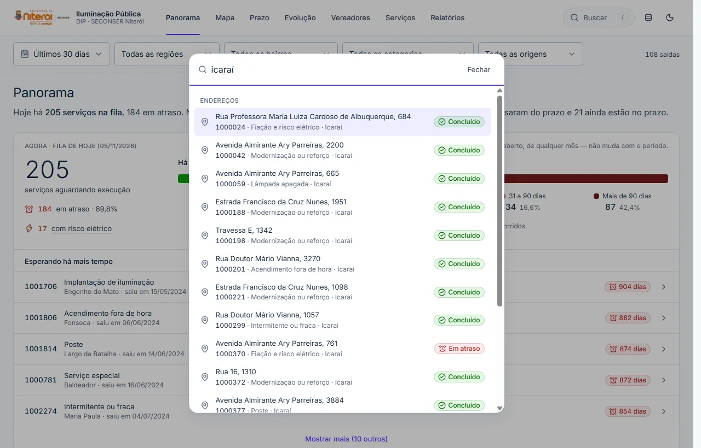<br><sub><b>Busca rápida</b> (tecla <code>/</code>) — número, rua ou endereço, com a situação de cada um</sub></td>
  </tr>
</table>

**Também:**
- **Filtros globais** (período, região, bairro, categoria, origem) ficam no endereço: valem em todas as páginas e o
  link filtrado pode ser compartilhado.
- **Atualiza sozinho:** a cada 2 minutos, com a aba aberta, o site confere se o banco recebeu uma carga nova e, se sim,
  busca os dados por trás, sem recarregar a página e sem perder a ficha, os filtros ou a rolagem.
- **Relatórios em PDF de verdade** (A4, prontos para imprimir em preto e branco ou mandar por WhatsApp):

  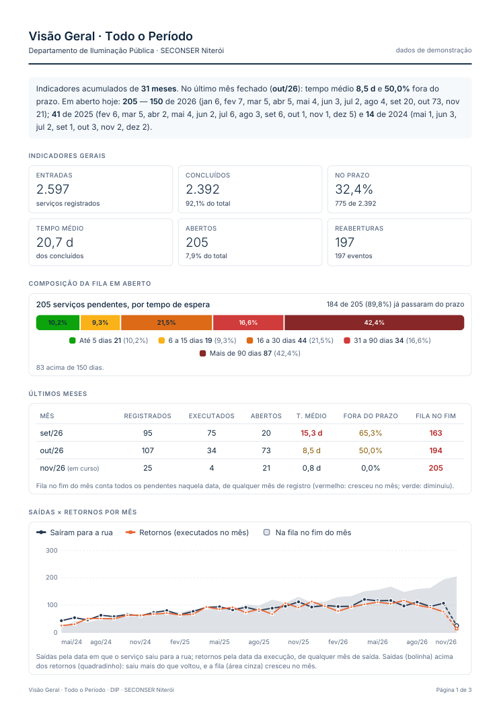

- **Celular e tema escuro:** navegação embaixo (no máximo 5 itens), tudo cabe de 320 px em diante.

<table>
  <tr>
    <td width="33%">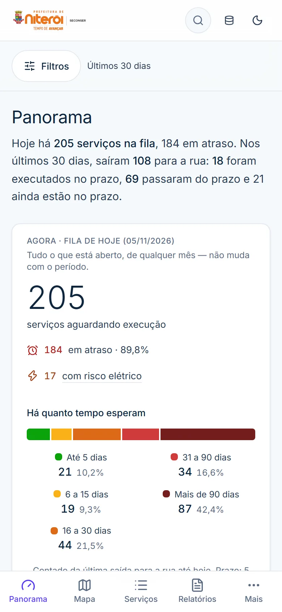</td>
    <td width="33%">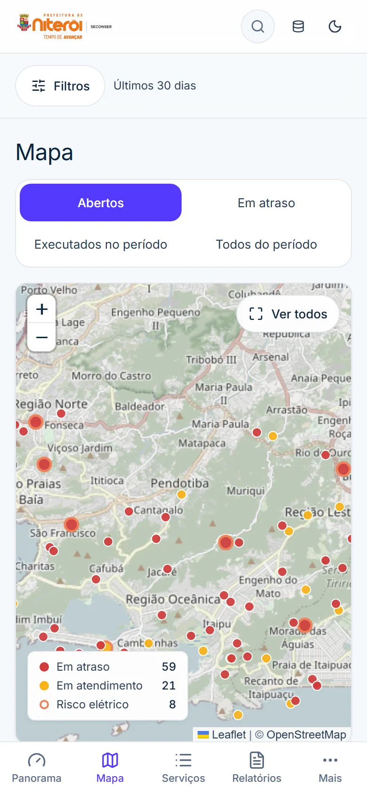</td>
    <td width="33%">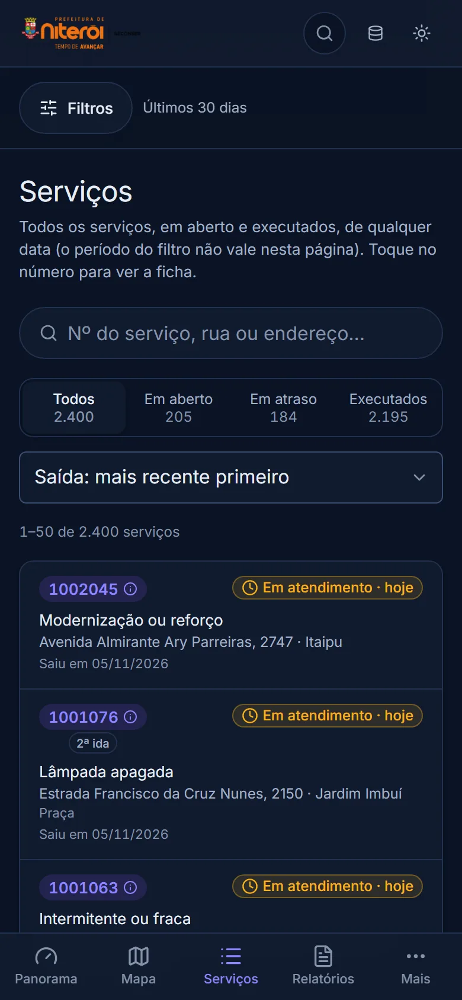</td>
  </tr>
</table>

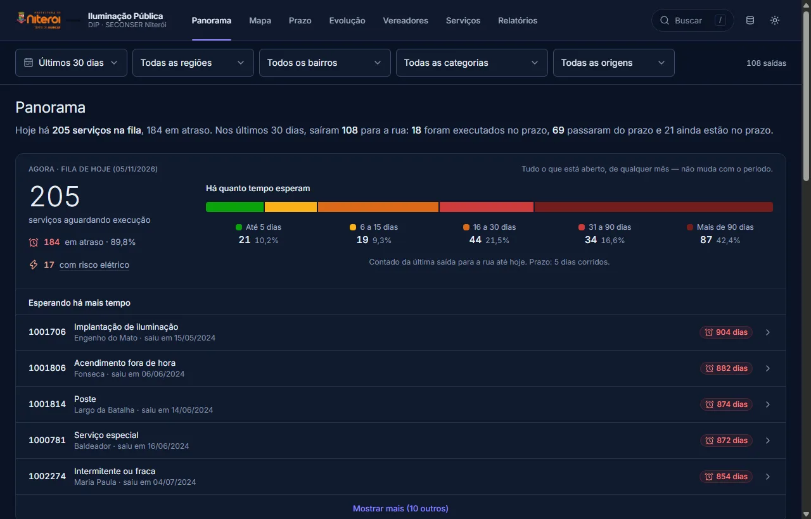

## Dados

```
Colab → banco da SECONSER (MySQL) → tratamento → sincronização (a cada 30 min no horário de trabalho) → Supabase → este site
```

O site lê do Supabase a camada pública (sem dados pessoais). A parte restrita (descrição, endereço, pino no mapa, fotos) exige login
e é protegida por regras de acesso no próprio banco (RLS) — ver `docs/SEGURANCA.md`. A coleta e o tratamento ficam em
outro repositório; dado real nunca entra neste.

Regras: uma linha = uma **saída para a rua**; um serviço pode ter mais de uma (reabertura). Com retorno → **executado**;
sem retorno e mais de 5 dias corridos desde a saída → **em atraso**; senão → **em atendimento**.

## Stack

Vite + React + TypeScript · Tailwind CSS · Base UI · TanStack Query · React Router · Leaflet (OpenStreetMap) ·
pdf-lib (relatórios em PDF) · Supabase (dados e login) · GitHub Pages · vitest. Gráficos em SVG próprio, com paleta
validada para daltonismo e para impressão em preto e branco (ver `DESIGN.md`).

## Rodar localmente

Precisa do Node 22 (Vite 8 pede ≥ 20.19 ou ≥ 22.12).

```bash
npm install
cp .env.example .env.local   # e ajuste: VITE_FONTE=supabase, ou csv + DADOS_LOCAIS=<pasta com os CSVs>
npm run dev                  # http://localhost:5173/dashboard-seconser/
```

- `VITE_FONTE=supabase` lê o banco publicado; `VITE_FONTE=csv` lê um retrato do banco em CSV de uma pasta **fora** do
  repositório.
- Dados de teste, só no `npm run dev` (`src/dev/cenarios.ts`, fora do site publicado), pelo endereço `…/?dados=<cenário>#/`
  ou pelo seletor no rodapé:

  | Cenário | Para quê |
  |---|---|
  | `demo` | demonstração (as imagens deste README): volume realista, sem casos de borda, nomes fictícios |
  | `pior` | o pior caso: nomes longos, campos faltando, pinos empilhados, pedido parado há 900 dias, base desatualizada |
  | `vazio`, `um`, `enorme` | nenhum serviço, três serviços, ~95 mil saídas (desempenho) |
  | `lento`, `erro`, `erro-restrito` | carregamento demorado e falhas de rede (estados de carregando e erro) |
  | `vivo` | uma carga nova a cada consulta (para ver o site se atualizar sozinho) |

| Comando | O quê |
|---|---|
| `npm test` | testes dos cálculos e dos textos dos relatórios (vitest, `src/testes/`) |
| `npm run lint` | oxlint |
| `npx tsc -b` | tipos |
| `npm run build` | gera o site em `dist/` |

## Publicação

Cada push no ramo `main` publica o site no GitHub Pages (`.github/workflows/publicar.yml`): instala, **roda os
testes** (se algum falhar, não publica e o site no ar fica como estava), confere os tipos e gera o site. Os endereços
do site antigo (`pages/mapa.html`, `/legado/`…) levam ao mesmo assunto no painel novo. O código do site antigo
(HTML + Apps Script, até outubro de 2026) fica guardado na marca `site-antigo`.

## Organização do código

| Pasta | O quê |
|---|---|
| `src/paginas/` | uma pasta/arquivo por página; `relatorios/` são as folhas da tela |
| `src/relatorios-pdf/` | os mesmos relatórios desenhados em PDF (motor próprio sobre o pdf-lib) |
| `src/calculos/` | os números de cada página e relatório, e os textos que a tela e o PDF dividem (sem React) |
| `src/dados/` | leitura (Supabase ou CSV), montagem da base, atualização automática e regras de negócio (`regras.ts`) |
| `src/filtros/`, `src/busca/`, `src/ficha/`, `src/mapa/` | filtros no endereço, busca rápida, ficha do serviço, mapas |
| `src/componentes/` | layout, gráficos, estados (carregando, vazio, erro) e peças de interface |
| `src/lib/` | datas, formatação de números e textos, cores (uma paleta só para tela e PDF), geo |
| `src/testes/` | testes dos cálculos, com uma base pequena montada à mão |
| `src/dev/` | cenários de dados de teste (`?dados=`), fora do site publicado |
| `docs/img/` | as imagens deste README |

## Documentação

- `docs/PLANO_V2.md` — plano, decisões e o que foi feito em cada rodada
- `docs/PUBLICACAO.md` — como o site foi ao ar (teste → troca → final)
- `docs/SEGURANCA.md` — acesso, dados restritos e auditoria
- `docs/CONFERENCIA_V2.md` — conferência dos números contra o site antigo
- `DESIGN.md` — sistema visual (cores, tipografia, gráficos, celular, estados)
